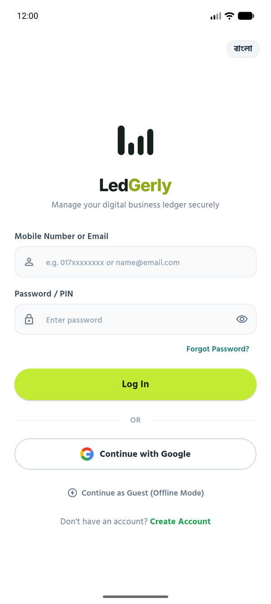
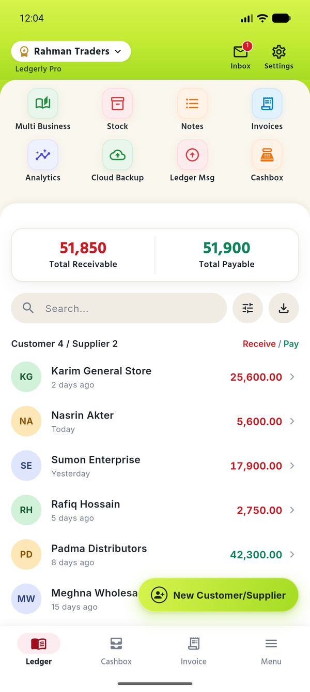
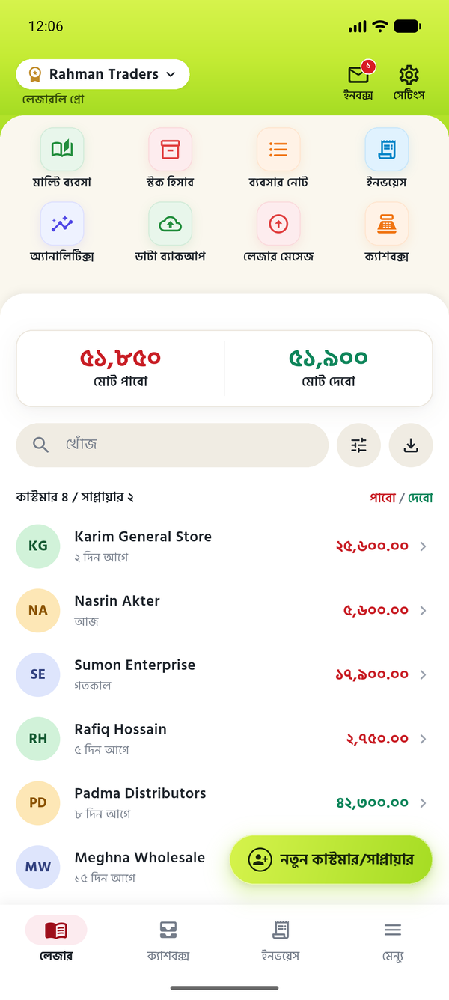
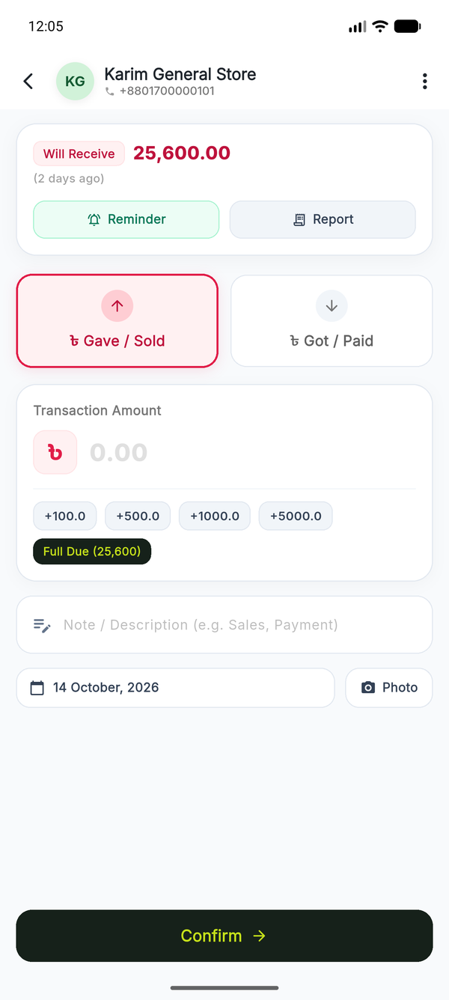
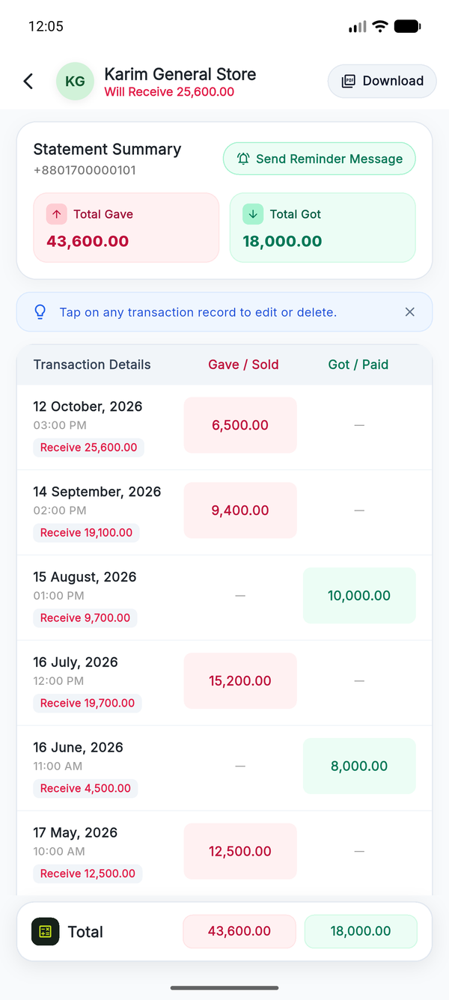
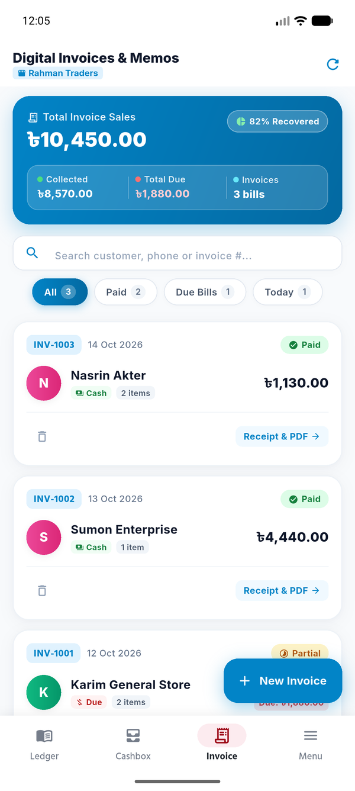
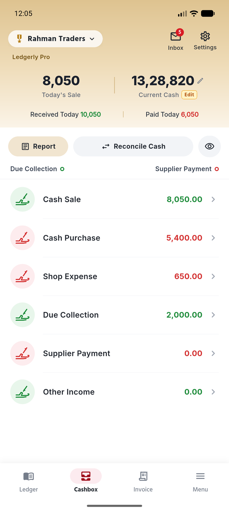
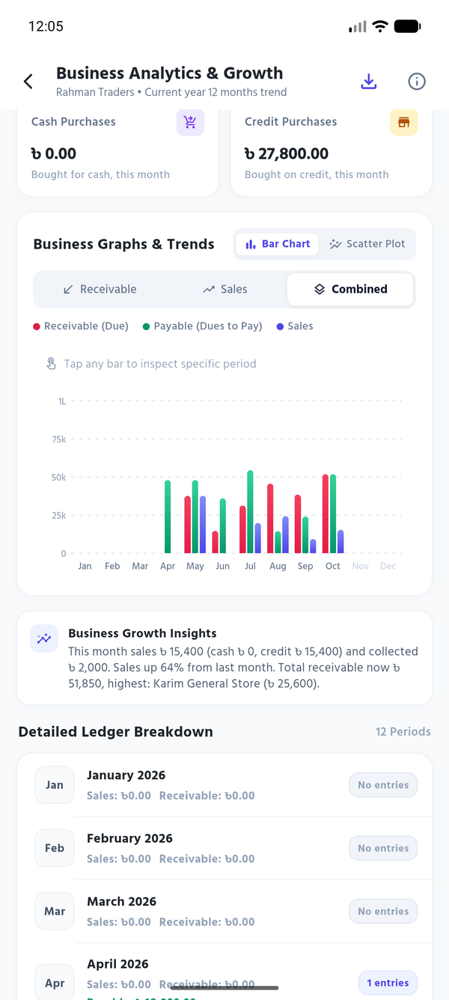
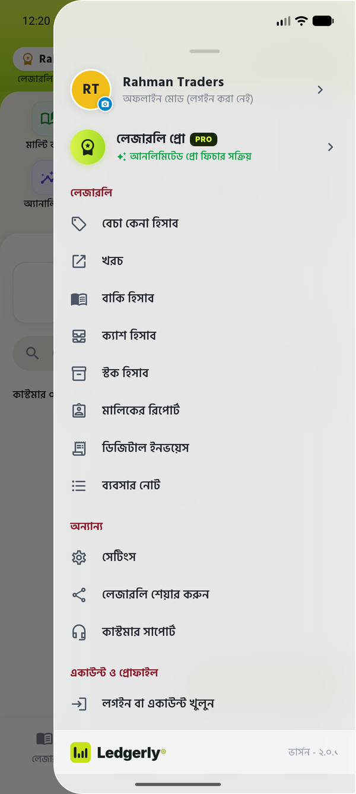

<div align="center">

# 📒 Ledgerly

**A credit book (*baki khata*) for small shops in Bangladesh — customers, suppliers, cash, invoices and stock, in Bangla or English, with or without internet.**


</div>

<p align="center">
  
  
  
</p>
<p align="center">
  
  
  
</p>
<p align="center">
  
  
  
</p>
<p align="center"><sub>Screenshots use a fictional shop and made-up customers.</sub></p>

> **About this repository.** The code here is an earlier snapshot (v1, Supabase sync). This README describes **v2.0.1**, a rewrite on Firebase that is being prepared for Google Play; its source will be pushed here with the release.

---

## What it does

| | |
|---|---|
| **Customer & supplier ledger** | Running balance per party (*pabo* / *debo*), cash sales, a photo of the paper receipt, built-in calculator keypad, one-tap WhatsApp reminder |
| **Statements** | Full transaction history per party, exported as an A4 PDF |
| **Cashbox** | Daily cash in/out by category, and reconciliation against the cash actually in the drawer |
| **Invoices** | Itemised invoices with paid / partial / due status and a printable receipt |
| **Stock & notes** | Stock in/out per product, and business notes |
| **Analytics** | Daily → all-time summaries and growth charts drawn with `CustomPainter` |
| **Multi-business** | Several shops in one account, each with its own isolated books |
| **Bilingual** | Every screen, amount and date in Bangla or English, switchable at any time |
| **Accounts** | Email, mobile number or Google sign-in — or a guest mode that never leaves the phone |

## How it works

```
 UI (Riverpod providers)
        │  every write
        ▼
 Drift / SQLite on the phone  ──── works fully offline
        │  on change, when signed in and online
        ▼
 Cloud Firestore  backups/{uid}            manifest: backup id, part count, record counts
                  backups/{uid}/blobs/…    gzip(JSON) split into < 1 MB parts
                  backups/{uid}/images/…   receipt and avatar photos, chunked
        │
 Cloud Functions  account deletion with an emailed code
```

The phone is the source of truth. The cloud holds a backup that a second phone, or a reinstall, can restore from.

## Problems worth reading about

**A backup that silently stopped working.** A Firestore document is capped at 1 MiB. A single-document backup passes every test with sample data, then quietly stops uploading once a real shop's ledger grows. Backups are now gzip-compressed JSON split into sub-1 MB parts, and photos are chunked the same way.

**"Couldn't read the cloud" is not "there is no backup."** If a network error is read as an empty cloud, the app starts a blank ledger, and the next auto-backup overwrites the real one. Read failures are thrown, never defaulted. Every backup also carries an id, so a phone refuses to upload over a backup written by another phone that it hasn't restored yet, and asks the user instead.

**Two phones, one account, no ping-pong.** A restore fires the same database-change events as a user edit. Without a guard, two phones would keep re-uploading each other's data forever. Restores are fenced off from the auto-backup trigger.

**Shared phones can't leak data.** The local database records which account owns it, and local backup files are scoped to the signed-in account. Signing in as someone else never shows the previous user's books.

**Account deletion is verified on the server.** A 6-digit code is emailed and checked inside a Cloud Function, with a 10-minute expiry and 5 attempts. The code never reaches the client, and Firestore rules keep that collection closed to the app.

## Tech stack

| Layer | Choice |
|---|---|
| App | Flutter, Dart 3 |
| State | Riverpod 3 |
| Local database | Drift on SQLite (schema v8, with migrations) |
| Auth | Firebase Auth: email, mobile number, Google |
| Cloud backup | Cloud Firestore, per-user security rules |
| Server | Cloud Functions for Firebase (Node 22) |
| PDF | `pdf` + `printing` |
| Fonts | Hind Siliguri (Bangla), Inter (English) |

## Project structure

```
lib/
├── core/            database, localization, theme, shared widgets, formatters
└── features/        one folder per feature: data / domain / presentation
    ├── analytics/   ├── backup/     ├── cashbox/    ├── home/
    ├── auth/        ├── business/   ├── customer/   ├── invoice/
    ├── notes/       ├── notifications/              ├── splash/
    └── stock/
functions/           Cloud Functions (account deletion)
firestore.rules      per-user access rules
test/                167 unit and widget tests
```

## Running it locally

You need the Flutter SDK and your own Firebase project. Firebase config files are not committed.

```bash
flutter pub get
flutterfire configure            # creates lib/firebase_options.dart and google-services.json
dart run build_runner build --delete-conflicting-outputs
flutter run
```

Run the tests:

```bash
flutter test
```

Deploying the server side (needs the Firebase Blaze plan):

```bash
firebase deploy --only firestore:rules
firebase functions:secrets:set GMAIL_USER
firebase functions:secrets:set GMAIL_APP_PASSWORD
firebase deploy --only functions
```

## Status

v2.0.1 is feature-complete and preparing for its first Google Play release. The account-deletion Cloud Function is written but not yet deployed.

## License

MIT — see [LICENSE](LICENSE).
